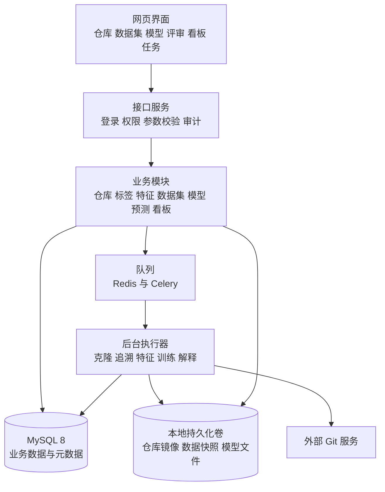
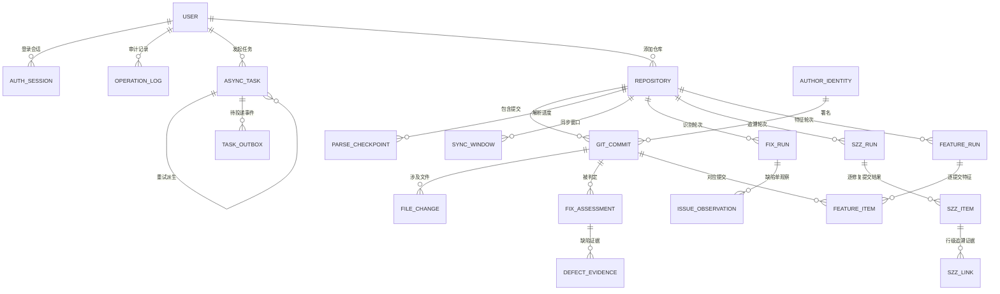
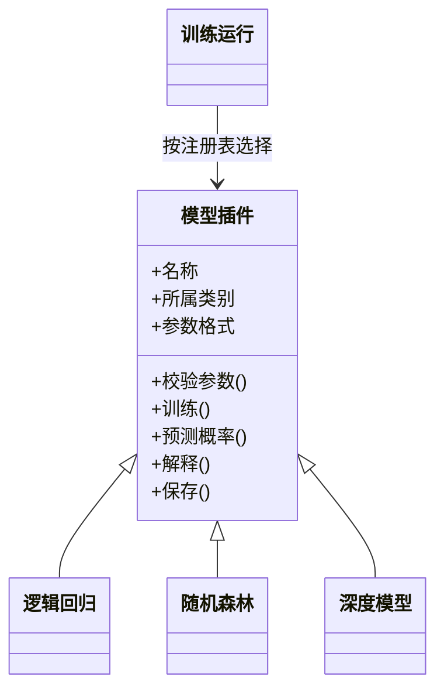
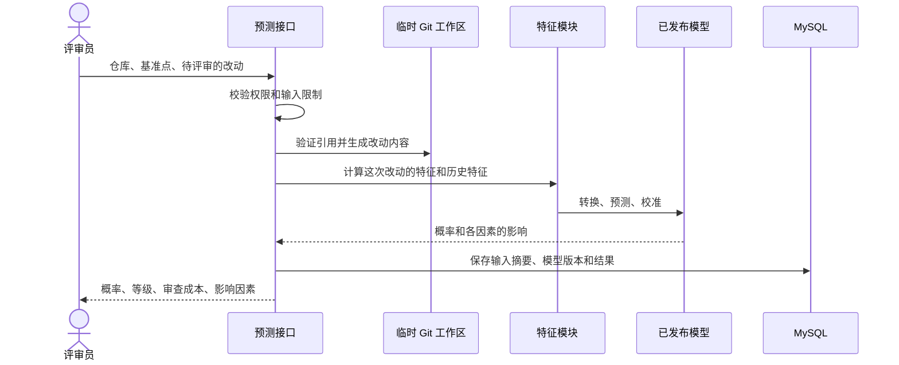
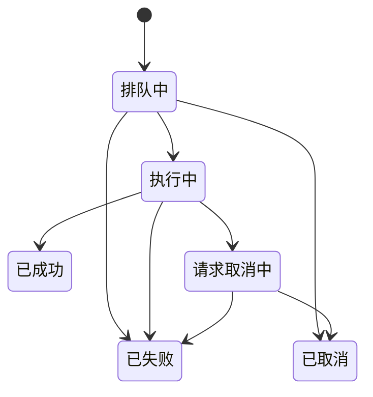

# DefectGuard 产品设计文档

## 一、版本信息

- 版本号：v2.0
- 创建日期：2026-10-16
- 文档负责人：DefectGuard 项目组

## 二、变更日志

| 时间 | 版本号 | 变更人 | 主要变更内容 |
|---|---|---|---|
| 2026-10-12 | v0.9 | DefectGuard 项目组 | 建立设计基线，写清总体架构、模块划分、任务模型和安全设计 |
| 2026-10-16 | v1.0 | DefectGuard 项目组 | 按课程《产品设计文档》模板重整全文：补齐版本信息、名词解释、概要设计、API 清单、数据库概要和详细设计；原先按开发阶段堆叠的技术记录移出本文档，过程细节移到 `docs/development/` 和 `docs/reports/` |

## 三、文档说明

### 名词解释

| 术语 | 说明 |
|---|---|
| 模块化单体 | 后端所有代码放在一个应用里，内部按业务分模块，但整体只部署一个服务。相比拆成一堆互相调用的小服务，这种做法的运维成本低得多 |
| 后台执行器 | 单独运行的一类进程，专门干活耗时的任务，比如克隆仓库、算特征、训练模型。接口服务把任务丢进队列就返回，不阻塞用户 |
| 队列 | 存放待执行任务的地方。本项目用 Redis 配合 Celery 来实现 |
| 幂等 | 同一个请求重复提交多少次，结果都和提交一次一样，不会产生重复数据 |
| 幂等键 | 调用方在请求里带上的一个标识。服务端靠它认出「这是同一个请求又来了」，而不是一次新请求 |
| 心跳 | 后台执行器定期写下一个「我还活着」的时间戳。超时没写，系统就认为这个执行器掉线了 |
| 租约 | 某个执行器领走一个任务时，系统给它一段时间的独占权。时间没续上就自动失效，别的执行器可以接手 |
| 投递记录 | 创建任务时，把任务本身和「还有一个消息要发出去」这件事写在同一个数据库事务里，之后由单独的投递器把消息送进队列。这样不会出现任务建好了但消息没发出去的情况 |
| 裸克隆 | 只把 Git 仓库的历史数据拉下来，不检出工作区文件。分析历史用它就够了，还省磁盘 |
| 提交标识 | Git 给每一次提交算出的一串唯一编号，用来指代某次具体的提交 |
| 数据库迁移 | 带版本号的数据库结构变更脚本。每加一个文件，就是对数据库结构做一次调整，可以往前也可以回退 |
| 检查点 | 记录「已经处理到哪了」的一个标记。任务中断后从检查点接着跑，不用从头再来 |
| 持续集成 | 每提交一次代码就自动跑一遍检查和测试的服务，出问题会显示成红色 |

## 四、概要设计

### 4.1 系统架构

系统整体是「一个接口服务 + 一组后台执行器 + 一个数据库」的结构。



这样分的理由很直接：克隆一个大仓库、算几万个提交的特征、训练一个模型，这些动作短则几十秒、长则几十分钟，不能让浏览器的请求一直等。所以凡是耗时的动作，接口服务只负责把任务登记下来并返回，真正的执行交给后台执行器，网页通过任务页面轮询进度。

至于为什么不拆成微服务：这个项目一共三到四个人，拆开之后光是服务之间的调用、部署和排查故障，成本就超过了它带来的好处。我们把它保持成一个应用，但如果将来某个模块真的需要独立部署，模块之间的边界已经划好了，拆起来不至于伤筋动骨。

### 4.2 系统模块划分

系统按业务分成九个模块。每个模块只负责一件事，模块之间通过应用服务的接口互相调用，任何模块都不允许直接去写别的模块的表。

| 模块 | 负责什么 | 对外提供什么 | 对应需求 |
|---|---|---|---|
| 账号与审计 | 登录、会话、角色权限、操作记录 | 登录凭证、角色判定、操作日志 | US-22、US-23 |
| 仓库管理 | 校验仓库地址、克隆、解析提交、增量同步 | 仓库、提交、文件变更 | US-01 ～ US-03 |
| 缺陷追溯 | 识别修复提交、追溯缺陷来源、判定标签成熟度 | 缺陷证据、追溯结果、提交标签 | US-04、US-05 |
| 特征 | 计算 14 维特征、生成语义输入、统计特征质量 | 提交特征、质量统计 | US-06、US-07、US-10 |
| 数据集 | 按时间切分、生成不可变快照、配置类别不平衡 | 数据集及其成员 | US-08、US-09 |
| 模型 | 模型注册、训练、评估、校准和发布 | 训练运行、模型产物 | US-11 ～ US-15 |
| 预测 | 处理候选改动、批量预测、生成解释 | 预测任务、预测结果 | US-16 ～ US-19 |
| 看板 | 汇总趋势和风险队列，支持下钻 | 聚合后的统计结果 | US-18、US-20 |
| 任务 | 幂等、心跳、重试、取消和掉线恢复 | 通用任务状态 | US-02、US-12、US-19、US-21 |

九个模块里，任务模块是底座——除了账号模块，其余模块所有耗时动作都要经过它。这也是为什么它在需求上横跨了四条用户故事，而不是归属某一个业务。

### 4.3 API 清单

接口统一挂在 `/api/v1` 下面，全部 35 个，按模块分组如下。每个接口的完整定义在 [API 与数据库规格](04-API与数据库规格.md) 里，代码生成的 OpenAPI 文档是最终依据。

| 模块 | 编号 | 数量 | 代表性接口 | 主要权限 |
|---|---|---|---|---|
| 账号与用户 | A01 ～ A06 | 6 | 登录、退出、查看当前用户、用户管理 | 公开、只读、管理员 |
| 仓库管理 | A07 ～ A11 | 5 | 添加仓库、仓库列表、增量同步、提交列表 | 可发起、只读 |
| 缺陷追溯 | A12 ～ A14 | 3 | 运行修复识别、启动缺陷追溯、查询行级证据 | 可发起、只读 |
| 特征 | A15 ～ A16 | 2 | 启动特征提取、查看特征质量 | 可发起、只读 |
| 数据集 | A17 ～ A19 | 3 | 创建数据集、数据集列表、数据集详情 | 可发起、只读 |
| 模型 | A20 ～ A23 | 4 | 发起训练、查看训练状态、发布模型、已发布模型列表 | 可发起、管理员、只读 |
| 预测 | A24 ～ A27 | 4 | 候选预测、批量预测、风险队列、预测解释 | 可发起、只读 |
| 看板与审计 | A28、A33 | 2 | 趋势数据、操作审计 | 只读、管理员 |
| 任务与健康 | A29 ～ A32、A34、A35 | 6 | 任务列表、任务详情、重试、取消、健康检查、诊断任务 | 只读、可发起、公开 |

### 4.4 数据库概要设计

数据库用 MySQL 8。下面的图是当前已经建出来的表以及它们之间的关系。



已经建出来的表共 20 张，按业务分成五组：

| 分组 | 张数 | 表 |
|---|---|---|
| 账号与审计 | 3 | 用户、登录会话、操作记录 |
| 任务与投递 | 2 | 异步任务、待投递事件 |
| 仓库与采集 | 6 | 仓库、作者身份、提交、文件变更、解析进度、同步窗口 |
| 缺陷追溯 | 7 | 识别轮次、逐提交判定、缺陷证据、缺陷单观察、追溯轮次、追溯项、行级证据 |
| 特征 | 2 | 特征轮次、特征项 |

标签、数据集和模型这三块目前只有设计，表还没建。这部分一共规划了七张：提交标签、数据集、数据集成员、训练运行、模型产物、预测任务、预测结果。它们对应的是项目后续要做的模型链路，设计口径见 [数据与算法规格](03-数据与算法规格.md)。

## 五、详细设计

### 5.1 各模块的详细设计

#### 5.1.1 仓库采集

一个仓库从被添加进来，到提交被解析完，中间要过几道关。

**地址校验。** 用户填进来的地址在真正使用之前要检查一遍：只允许 HTTPS，不允许地址里内嵌用户名密码，不允许指向内网、本机或者保留地址，端口也限制在常规范围内。这里有个容易被忽略的地方——地址第一次通过检查不代表后面就安全，因为对方可以在我们检查完之后把域名解析改到一个内网地址上（这类攻击叫 DNS 重绑定）。所以每次重定向之后都要重新校验一遍地址和域名解析结果，真正发起连接时再用校验过的那个具体地址。

**克隆与解析。** 校验通过之后执行裸克隆。解析出来的提交按确定的顺序处理，每处理完一批就更新检查点。如果中途执行器掉线，新的执行器从检查点接着跑，已经入库的提交不会重复入库——这一点靠数据库上的唯一约束保证，而不是靠「先查一下有没有，没有再插」这种写法，后者在并发下会漏。

**增量同步与历史改写。** 同步不是原地更新已有的克隆，而是重新做一次完整的安全克隆，然后和上次的记录比对，只处理新增的提交。如果发现仓库被强制推送过、历史被改写了，系统不会默默删掉已有记录，而是把仓库标成「需要人工确认」并停下来。这比悄悄处理掉一个不可解释的状态要安全。

#### 5.1.2 缺陷追溯

缺陷追溯分两步：先从提交历史里找出哪些提交是修复缺陷的，再从这些修复提交出发，往回找出缺陷当初是谁引入的。

第一步的判断依据是提交信息和已确认的缺陷单。这里有一个刻意的保守设计：提交信息里出现一个缺陷单编号，并不足以判定这就是修复提交——必须有关键词或者已经人工确认过的缺陷单作为佐证，否则会被归到「无法判定」而不是「不是缺陷」。识别规则本身带版本号，规则改了之后旧结果仍然可以追溯。

第二步的难点在于证据要留得住。追溯不能只给一个「这次提交引入了缺陷」的结论，还要把中间过程留下：改了哪个文件、修掉了第几行、这一行当初是被哪次提交写下的。所以追溯结果是行级的，每一行都指向一次具体的提交和一个具体的位置。如果某次涉及的历史提交没有本地记录，系统会保留成「未知」，不会为了凑齐关系去伪造一条记录。

#### 5.1.3 特征与数据集

特征这一层要做的是把一次提交变成一个模型能读的数值向量，用的是公开的 14 维代码改动度量，比如改动行数、涉及文件数、开发者过去一段时间在这个子系统里的活跃度等。

这里最关键的设计约束是**时间**。任何一个提交的特征，只能使用这个提交发生当时就已经存在的信息。举例来说，判断某次提交历史上是否经常出问题，只能看它之前的数据，绝对不能把它之后发生的事实算进去。这条约束贯穿特征计算、数据集切分和模型训练三个阶段，是防止结果虚高的核心。

数据集这一层负责按时间先后把提交切成训练、验证、测试三份，然后生成一个不可变的快照。切成快照的意义在于：训练记录指向的快照内容永远不会变，这样几个月后回头重跑同一次训练，用的还是同一批数据。所有需要「学习」的环节——比如数值的归一化、文本词表的构建——都只在训练集上做，然后原样套用到验证集和测试集，否则仍然等于偷偷把未来的信息用上了。

#### 5.1.4 模型训练

模型这一层用插件的方式组织。每个模型实现同一套接口，注册表里登记它的名字、属于经典模型还是深度模型、接受哪些参数。这样做的好处是加一个新模型不用改动训练流程本身，只要实现接口再登记一下。



一次训练要做的事情是：读数据集快照，按选定的参数训练，在验证集上调出判定阈值并做概率校准，最后在测试集上算指标。校准这一步值得解释一下——原始模型输出的分数只是一个相对高低，校准之后才能说「0.8 大致对应 80% 的出错概率」，评审员看这个数字才有意义。

训练的所有输入都要记下来：代码版本、数据集、特征和标签的版本、依赖摘要、随机种子和参数。最后产出模型的哈希值。这样才能做到任意一次训练都可以重跑并比对。

#### 5.1.5 风险预测

预测这条链路是系统的核心交互，从评审员提交一个待评审的改动，到拿到风险结果，中间的过程如下：



几个关键点：待评审的改动在一个隔离的临时工作区里处理，用户传进来的路径不会被直接拼进命令里，仓库里的脚本也不会被执行。历史特征严格截止到基准点，不使用基准点之后的信息。如果计算时间超过了同步返回的时限，接口会先返回任务编号，由任务页面查询结果。

#### 5.1.6 异步任务

因为系统里几乎所有耗时的动作都走任务，任务模块本身的设计就等于整个系统的可靠性基础。

任务的状态变化如下：



几条约束：

- 到了终态的任务不会再回到排队中。重试是新建一个全新的任务，通过一个字段指向原来那个任务，原任务的失败记录保持不动。
- 「失去心跳」不是一个任务状态，而是一个由租约和心跳算出来的健康判断。这样设计是因为任务可能只是执行器卡住了，记录本身的状态并没有错。
- 重复提交靠数据库上的唯一约束挡住，约束由「任务类型 + 作用域 + 幂等键」三者组合而成。前面提过，靠先查询再插入的写法在并发下挡不住。
- 创建任务和投递任务消息写在同一个事务里，再由投递器发送。发送失败会按上限和退避策略补投。因为消息可能重复送达，执行器必须靠原子领取和执行令牌来拒绝重复执行，以及拒绝已经过期的执行器写回结果。
- 取消是协作式的：在执行器跑到下一个安全检查点时才会真正停下，这样可以保证不会留下写了一半的数据。

#### 5.1.7 权限、隐私与审计

系统里有三种角色，权限依次叠加：

| 角色 | 能做什么 |
|---|---|
| 只读 | 查看仓库、数据质量、指标、预测结果和看板 |
| 可发起 | 只读的全部权限，加上发起仓库采集、特征提取、训练和预测任务 |
| 管理员 | 可发起的全部权限，加上发布模型、管理用户和查询审计 |

公开注册默认关闭，第一个管理员由部署配置直接创建。模型发布、角色变更、任务取消和重试这几个动作必须留下操作记录。

隐私方面，提交作者的邮箱在入库前做哈希或别名化处理，普通导出里不包含原始邮箱。Git 凭据和应用密钥通过环境注入，不写进数据库、命令行和日志。访问外部仓库时用到的凭据只在这一类受控动作里使用。

运行情况方面，接口、数据库、队列和执行器各自有健康检查，日志里统一带上请求编号、任务编号和运行编号，方便串起一次完整的调用。对外公开的健康检查只返回必要状态，不暴露版本号和内部地址。

#### 5.1.8 部署与运行环境

用 Docker Compose 拉起整套环境，包含网页、接口服务、后台执行器、MySQL 和 Redis 五个部分。仓库镜像、数据快照和模型文件放在具名的持久化卷里，不会因为重启容器而丢失。接口服务和后台执行器用的是同一个镜像，只是启动命令不同，这样能保证两边的代码版本永远一致。

开发环境允许各个组件单独启动，但配置结构必须和生产一致，避免出现「本地能跑、换台机器就不行」。配置按环境分层，密钥只通过不提交到仓库的环境文件或密钥管理服务注入。

### 5.2 API 详细设计

所有接口遵循同一套约定：

- 基础路径为 `/api/v1`，请求和响应里的字段名用小写加下划线。
- 所有业务对象的编号用 UUID，时间统一用 UTC 时间。
- 同步创建资源返回 201；创建异步任务或接受一次取消请求返回 202；任务已经取消且没有响应内容时返回 204。
- 出错时返回固定的结构：错误码、给用户看的说明、请求编号，以及可选的细节。响应里不包含调用栈、SQL、本机路径、命令行和依赖版本号——这些信息对用户没用，泄露出去却是风险。
- 写接口接受幂等键，同一个作用域里重复提交会返回原来那个资源，或者明确报冲突。
- 分页参数统一，每页最多 100 条。

以添加仓库为例（对应 A07）：

```json
{
  "url": "https://github.com/example/project.git"
}
```

返回 202：

```json
{
  "repository_id": "uuid",
  "task_id": "uuid",
  "status": "queued"
}
```

接口只接受这一个字段，传入其他字段会返回 422，而不是忽略掉。

再以候选预测为例（对应 A24）：

```json
{
  "repository_id": "uuid",
  "model_run_id": "uuid",
  "base_ref": "main",
  "candidate_ref": "feature/example"
}
```

待评审的改动可以直接给一个分支引用，也可以给一段改动内容，两者必须且只能提供一个。成功返回：

```json
{
  "prediction_id": "uuid",
  "probability": 0.82,
  "calibration": "isotonic-v1",
  "risk_level": "high",
  "effort": 126,
  "top_factors": [
    {"feature": "la", "value": 92, "contribution": 0.18, "direction": "increase"}
  ],
  "limitations": ["因素贡献不代表缺陷的因果根因"]
}
```

错误码按前缀分组，前端按前缀就能判断该往哪个方向提示：

| 前缀 | 覆盖范围 | 举例 |
|---|---|---|
| AUTH | 登录和权限 | 凭证失效、角色不够、用户被禁用 |
| REPO | 仓库输入和状态 | 地址被拒绝、克隆失败、强推待确认 |
| DATA | 标签、特征和数据集 | 成熟样本不足、版本不匹配、泄漏审计未通过 |
| MODEL | 训练和模型 | 参数非法、模型文件校验失败、特征格式不兼容 |
| PRED | 预测 | 引用不存在、改动超限、基准点不可达 |
| TASK | 异步任务 | 当前状态不允许该操作、任务已掉线、取消冲突 |
| SYSTEM | 基础设施 | 依赖暂时不可用、内部错误 |

错误码是稳定的字符串，前端根据它来判断，不依赖中文说明文字，以免改一句文案就影响前端行为。

接口的最终定义以代码生成的 OpenAPI 文档为准，持续集成会检查文档和代码是否已经对不上。

### 5.3 数据库表的设计

表的设计遵循几条共同原则：表的编号用 UUID，时间统一用 UTC；每张表都带创建和更新时间；外键关系由数据库本身保证，不靠应用代码去模拟唯一性；批量写入用事务和批量插入，检查点只在一批数据成功提交之后才推进。

各表按业务分组如下：

| 分组 | 表 | 用途 | 关键约束 |
|---|---|---|---|
| 账号与审计 | 用户 | 系统账号、角色和启用状态 | 用户名唯一；普通查询不返回密码 |
| | 登录会话 | 可撤销、可轮转的登录凭证 | 刷新凭证唯一 |
| | 操作记录 | 关键操作的审计留痕 | 记录操作者、动作、对象和结果 |
| 任务与投递 | 异步任务 | 通用长任务的状态与健康 | 任务类型、作用域、幂等键三者组合唯一 |
| | 待投递事件 | 创建任务时要发出的消息 | 任务与事件类型组合唯一，保证至少投递一次 |
| 仓库与采集 | 仓库 | 仓库地址与采集状态 | 规范化后的地址唯一 |
| | 作者身份 | 提交作者归并后的身份 | 按版本记录，同一个人可以有多版本身份 |
| | 提交 | 提交的元数据 | 同一个仓库里的同一个提交只存一条 |
| | 文件变更 | 提交里每个文件的改动情况 | 归属于某次提交 |
| | 解析进度 | 解析到哪个位置了 | 每批成功后推进，退回不越界 |
| | 同步窗口 | 一次增量同步的范围和结果 | 固定基准点和待处理范围，重试沿用同一个 |
| 缺陷追溯 | 识别轮次 | 一次修复提交识别的输入与规则 | 冻结输入快照和规则版本 |
| | 逐提交判定 | 对某个提交是不是修复提交的判定 | 保留判定依据和复核结果 |
| | 缺陷证据 | 判定所依据的证据 | 归属于某条判定 |
| | 缺陷单观察 | 从缺陷单里观察到的信息 | 冻结采集时点，不随后续变化 |
| | 追溯轮次 | 一次缺陷来源追溯的输入与算法 | 固定算法版本和标签版本 |
| | 追溯项 | 每个修复提交的追溯结论 | 保留使用的改动范围和截止时间 |
| | 行级证据 | 追溯过程中每一行的来源 | 归属于某个追溯项 |
| 特征 | 特征轮次 | 一次特征计算的冻结输入 | 固定特征版本和输入摘要 |
| | 特征项 | 每个提交的 14 项特征值 | 记录缺失原因，不用零值代替缺失 |

有三条约束值得单独说，因为它们是踩过坑才定下来的：

第一，缺失不写零。某一项特征算不出来的时候，存的是「不知道」加上原因，而不是填 0。填 0 会让模型把一个「没数据」的提交当成「改动量为零」，这是两种完全不同的情况。

第二，同一个提交的特征不是靠「提交编号加特征版本」唯一的，还要绑上这次计算用的是哪一份冻结输入。否则两次输入不同的计算会互相覆盖。

第三，投递记录的存在本身就是为了消灭一个经典的错误时序：先建任务成功、再发消息失败，任务就永远卡在排队中。把它和任务写进同一个事务之后，这个窗口就不存在了。

## 附录

### 相关文档

| 文档 | 内容 |
|---|---|
| [产品需求文档](01-产品需求文档.md) | 目标用户、需求范围、功能说明和非功能性需求 |
| [数据与算法规格](03-数据与算法规格.md) | 缺陷追溯、14 维特征、数据集切分和评估指标的具体口径 |
| [API 与数据库规格](04-API与数据库规格.md) | 35 个接口的完整定义、请求响应格式、错误码和表结构 |
| [测试与验收计划](05-测试与验收计划.md) | 测试分层、质量门槛和证据要求 |
| [界面与交互规格](08-界面与交互规格.md) | 信息架构、页面状态和关键交互 |
| [低保真原型](prototype/low-fidelity-wireframes.html) | 可直接点击浏览的页面原型 |

### 开发过程记录

各阶段的实现边界、遇到的问题和验收结果，按时间记录在 [docs/reports/](reports/) 的十八份阶段报告里，配套的设计取舍记在 [docs/development/](development/) 的对应说明中。本文档只描述系统当前的设计，不重复这些过程记录。
