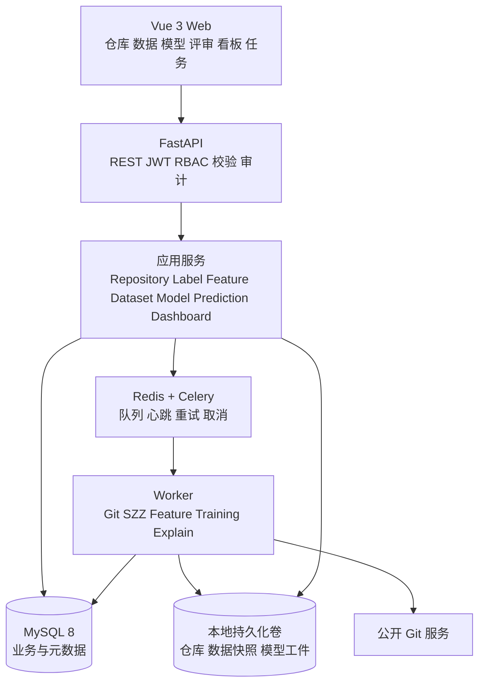
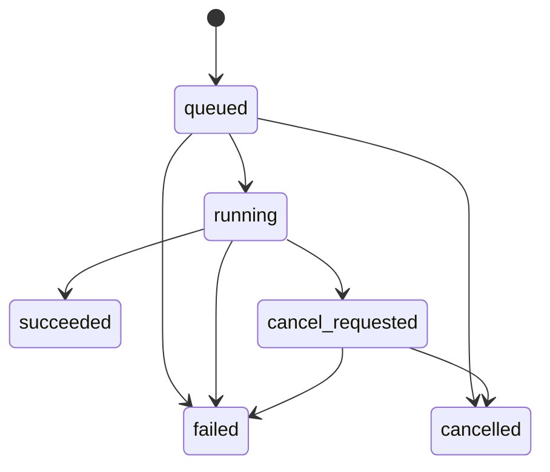
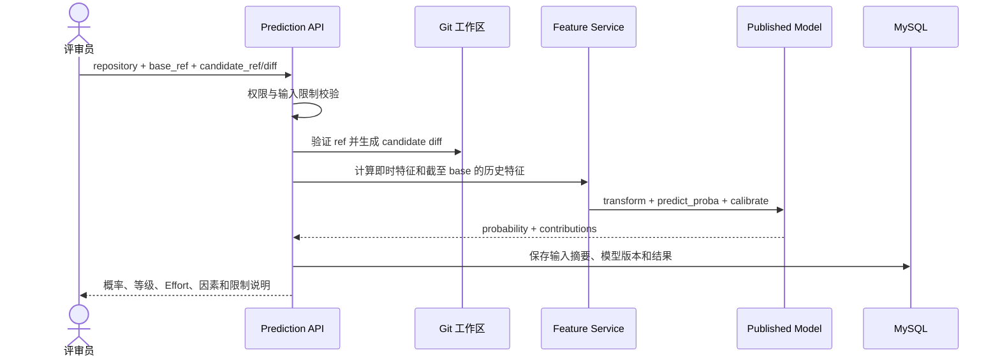

# DefectGuard 系统架构与详细设计

2026-10-12 第十七阶段当前边界（优先于下文历史阶段描述）：v2 数值使用文件事件索引/线性祖先复用/密集路径旧扫描，与未修改v1数值及缺失原因精确等价；新代码绑定v2规则摘要，旧轮次不改写。A15/A16版本/原生Git绑定及质量合同保留，schema仍0008_features，35项接口编号不变。性能优化不证明标签完整；A17～19/来源认证/模型与预测仍待后续。见 [当前指导](development/v2文件历史索引与验收.md)。

## 1 设计原则

1. 时间因果优先：任何提交的历史特征只能使用当时可得的数据。
2. 版本优先：标签、特征、数据集、训练、工件和预测显式记录版本。
3. 证据优先：Fix、SZZ、指标和测试结果均可追溯。
4. 先纵切后扩展：先交付小数据端到端链路，再扩展模型与评审入口。
5. 模型辅助人：模型用于排序，最终决策由评审者完成。
6. 安全默认开启：外部 URL、凭据、diff 和模型工件均按不受信输入处理。

## 2 总体架构

系统采用模块化单体与异步 Worker。API 保持统一部署，计算密集和长时间任务由 Celery Worker 执行，避免 3 至 4 人团队承担微服务治理成本。



## 3 模块划分

| 模块 | 职责 | 主要输入和输出 | 对应需求 |
|---|---|---|---|
| M1 Auth/Audit | 登录、会话、RBAC、操作审计 | token、角色、operation_log | US-22～23 |
| M2 Repository | URL 校验、克隆、解析、同步 | repository、commit、file_change | US-01～03 |
| M3 Label | Fix 证据、SZZ、成熟度和抽检 | defect_evidence、szz_link、commit_label | US-04～05 |
| M4 Feature | Kamei 14、语义输入、质量统计 | commit_feature、semantic artifact | US-06～07、10 |
| M5 Dataset | 时间切分、不可变快照、不平衡配置 | dataset、dataset_item | US-08～09 |
| M6 Model | 插件注册、训练、评估、校准和发布 | model_run、model_artifact | US-11～15 |
| M7 Prediction | 候选 diff、批量预测和解释 | prediction_task、prediction_result | US-16～19 |
| M8 Dashboard | 趋势、风险队列和下钻 | 聚合结果 | US-18、20 |
| M9 Task | 幂等、心跳、重试、取消和 stale 恢复 | async_task | US-02、12、19、21 |

模块之间通过应用服务接口协作，不允许跨模块直接写对方表。基础设施实现通过依赖注入接入领域接口。

## 4 推荐目录结构

```text
softwaretest/
├─ apps/
│  ├─ api/                 # FastAPI 入口、路由和依赖注入
│  ├─ worker/              # Celery 任务入口
│  └─ web/                 # Vue 3 前端
├─ packages/
│  ├─ domain/              # 领域模型、状态机和服务接口
│  ├─ mining/              # Git、Fix、SZZ
│  ├─ features/            # Kamei 和语义输入
│  ├─ ml/                  # 模型插件、指标、校准和解释
│  └─ persistence/         # SQLAlchemy、仓储和工件存储
├─ tests/
│  ├─ unit/
│  ├─ integration/
│  ├─ e2e/
│  ├─ data/
│  ├─ performance/
│  └─ security/
├─ docs/
├─ openspec/
├─ deploy/
└─ pyproject.toml
```

前端依赖和锁文件放在 `apps/web/`；Python 采用根级工作区配置和锁文件。运行时数据、仓库镜像、模型和密钥不得提交到 Git。

## 5 仓库采集设计

### 5.1 URL 安全

首期只允许 HTTPS。若以后支持 SSH，必须由管理员配置受信主机及独立 deploy key。

1. 拒绝 URL 内嵌凭据、非允许协议、异常端口和语法错误。
2. 解析全部 A/AAAA 地址，拒绝 loopback、私网、链路本地及保留地址。
3. 每次重定向后重新校验 URL 和 DNS。
4. 连接时固定或复核已校验地址，防止 DNS rebinding。
5. 限制仓库大小、克隆时间、diff 规模及并发任务数。
6. 错误响应不得包含本机路径、命令参数、凭据或依赖版本。

### 5.2 解析和同步

- 首次采集记录默认分支 head 和解析边界。
- 提交按确定性拓扑和时间顺序处理；每批 upsert 后保存 checkpoint。
- `repository_id + commit_sha` 唯一，重试不产生重复提交。
- 合并提交保留，但 baseline SZZ 和训练默认跳过；策略写入版本。
- 强推或祖先关系破坏时将仓库标记为 `requires_review`，不得静默删除历史。

## 6 异步任务设计

### 6.1 状态机



终态任务不回到 queued。重试单独创建初始状态为 queued 的 successor，通过 `retry_of` 关联原任务。`stale` 是由租约/心跳计算的健康标记，不是独立生命周期状态。

### 6.2 幂等、心跳与恢复

- 写任务接受 `Idempotency-Key`。
- 数据库唯一约束 `(task_type, scope_key, idempotency_key)`，禁止使用“先查再插”作为唯一防重手段。
- Worker 定期更新租约和心跳；超过阈值标记 stale，由协调器决定恢复或失败。
- 重试创建 successor 并通过 `retry_of` 关联，不覆盖原失败记录。
- 取消是协作式取消，在批次或安全检查点读取标志并保持事务一致。
- 默认自动重试不超过 3 次；不可重试错误直接失败。
- 任务记录与 outbox 待投递事件在同一数据库事务中写入；独立投递器发送至 Celery，失败时按上限与退避策略补投。投递采用至少一次语义，Worker 必须通过原子领取和执行令牌拒绝重复执行及过期 Worker 写回。
- 已过期任务由协调器核实租约后转为明确失败；需要恢复时创建 successor，不修改原任务的终态记录。取消请求与成功写回必须使用条件更新确定唯一结果。

以上最小认证和任务可靠性启动决策见 [首阶段设计决策](decisions/2026-09-26-最小认证与任务可靠性.md)。

## 7 预测运行链路



候选 diff 在隔离临时工作区处理。不得将用户提供的路径直接拼接进命令，也不得执行仓库内脚本。

## 8 模型插件设计

模型插件统一实现以下能力：

```python
class ModelPlugin(Protocol):
    name: str
    family: Literal["classic", "deep"]
    input_schema: str

    def validate_params(self, params: dict) -> None: ...
    def fit(self, train, valid, seed: int): ...
    def predict_proba(self, data): ...
    def explain(self, data): ...
    def save(self, path): ...

    @classmethod
    def load(cls, path): ...
```

插件不得自行读取任意用户路径。加载工件前验证类型、来源和 SHA-256；不反序列化不受信工件。

## 9 权限与审计

| 角色 | 权限 |
|---|---|
| Viewer | 查询仓库、数据质量、指标、预测和看板 |
| Member | Viewer 权限，加发起仓库、特征、训练和预测任务 |
| Admin | Member 权限，加模型发布、用户管理和审计查询 |

默认关闭公开注册。首次管理员通过部署配置创建。短期 access token 与可撤销 refresh/session 配合使用。模型发布、角色变更、任务取消和重试必须写操作审计。

最小登录、预置账号和角色校验在框架阶段实施；完整用户管理页面后置。预置账号密码由本地环境配置注入，不提交默认可用密码。

## 10 隐私、供应链与可观测性

- 作者身份归并后保存哈希或别名，普通导出不包含原始邮箱。
- Git 凭据和应用密钥通过 secret 注入，不进入数据库、命令行和日志。
- Python 和 Node 依赖必须锁定；CI 生成依赖审计结果。
- 统一记录 `request_id`、`task_id`、`run_id`，结构化日志不得含敏感信息。
- 指标至少包含队列长度、任务耗时、失败率、stale 数、预测延迟和模型缓存命中率。
- 健康检查区分 API、MySQL、Redis、Worker 和工件存储；公开端点只返回必要状态，不暴露版本和内部地址。

## 11 部署设计

Docker Compose 至少包含 `web`、`api`、`worker`、`mysql` 和 `redis`。仓库镜像、数据快照和模型工件使用具名持久化卷。API 与 Worker 使用同一版本镜像，通过不同启动命令运行。

第七阶段初次解析窗口通过repository.parse复用outbox/租约。受控原生Git读取固定bare HEAD，PyDriller只分析受限hunk；批次与checkpoint/最终成功原子，旧worker失效，已发布Git不被解析清理。作者身份邮箱哈希/版本化，commit和file唯一/外键由MySQL保证。策略及后续历史覆盖度约束见 [解析指导](development/提交解析与验收.md)。

开发环境允许直接启动组件，但必须使用相同配置结构。配置按环境分层，密钥仅通过未提交的环境文件或 secret 管理器注入。


## 第六阶段实现映射

仓库入口已按 add-data-collection 的克隆切片实施：Repository API/Service 接收公开 HTTPS，URLPolicy 与每次 CONNECT 的数值 IP 绑定负责网络防护；GitAdapter 使用独立租约目录和原生 Git bare clone；既有 TaskService/outbox/Redis/Worker 负责异步执行。repository+任务+outbox+审计原子受理，元数据+storage_key+成功状态以有效租约原子发布。容器 API/Worker 共享 D 盘 bind，容量检查覆盖受理、执行和运行周期；无 C 盘回退。空仓库无法确认 HEAD/默认分支时记录 null，不把本地 Git 默认值当远端事实。

该第六阶段说明的解析/checkpoint、同步已在第七/八阶段实施；第九阶段Fix见下节。SZZ与模型仍后续实施；网络与文件生命周期见 [采集设计](../openspec/changes/add-data-collection/design.md) 及 [安全克隆说明](development/安全仓库克隆与验收.md)。

## 第九阶段Fix实施

M3增加mining/fix_rules、issues及FixService，复用ParseExecutor监督Git可达集合和任务协调器。0006保存固定接受快照/规则的fix_run、独立fix_assessment/defect_evidence及冻结issue_observation；证据批次与checkpoint同事务，人工复核与审计同事务。活动Fix与同步互斥，requires_review仍暂停，未引入SZZ/标签。完整边界及模块复验见 [Fix指导](development/Fix证据与验收.md)。


## 第八阶段同步实现边界

同步采用独立完整安全clone，不原地fetch已发布仓库。repository独立sync_status保存requires_review，旧clone/parse状态兼容；同步窗口固定base/candidate及规则，重试同一候选。new ^base集合按事件时间/SHA排序，不用时间戳筛新提交。最后批次原子推进HEAD/存储引用；失败保留批次，强推/分支改变保留候选并暂停。指导见 [同步说明](development/增量同步与验收.md)。

## 第十阶段独立SZZ实施

新增repository.szz任务及szz_run/item/link，复用任务/outbox与原生Git监督；冻结Fix/复核/接受快照/时间，逐批原子证据与进度，真实Worker恢复。无负标签/特征/模型交付，见 [SZZ指导](development/SZZ追溯与验收.md)。

## 第十一阶段特征内核切片

`packages/mining/features.py` 为无 DB/网络写入的冻结计算内核，`feature_inputs.py` 用现有受监督 NativeReader 只读校验 Git modes/blob 后投影输入。提供 kamei14-dg-v1、完整/最近覆盖、祖先/事件时间、路径生命周期、FIX 可用时间、缺失原因与原始分位数，见 [Kamei指导](development/Kamei14计算与验收.md)。下一切片固定 feature_run 输入和原子结果、复用 outbox/fencing/lease/恢复，实施 A15/A16 和质量页面；本批尚无特征表/业务任务/API。成熟度/数据集/模型在其后，不把纯内核完成当整条业务链路完成。


## 第十二阶段特征纵向接入（2026-10-11）

US-06/07个人wang实现A15/A16、feature_run/item（0008_features）、repository.feature可靠任务与FeaturePanel质量页。固定接受HEAD/private快照/解析身份/覆盖/用途/Fix复核，Worker可达性排除未接受并集，冻结输入后每10结果原子发布/恢复；旧令牌与变更输入拒绝。完整质量只在全部发布后出现，缺失保留原因，提供稳定分页/缺失和数值降序下钻。不得构造标签、拟合填充或将晚到FIX回填；US-08/09及A17～19成熟度/不可变数据集与模型仍待后续。详情见 [Kamei指导](development/Kamei14计算与验收.md)；完成验收结果另写本批报告，不标记团队故事Done，不归档change，仅wang。

## 第十五阶段独立历史研究内核

causal_features/historical_replay纯计算与宿主只读probe_causal_features分开；前者剥除未来Fix再哈希，后者绑定明确来源/政策/向量/证据/分组purge。没有新在线依赖或表；调用适配器须认证覆盖/祖先/金标。现有生产观察和API不接受新版本，下一纵向阶段设计版本冻结/可靠恢复再接入。详见 [当前指导](development/历史回放与可知特征验收.md)。

## 第十六阶段在线 v2 适配

复用原 feature_service 任务/表，不另建队列。新 feature_versions 适配器核验已接受原生 Git、冻结最小消息用途与数值输入、调用既有独立 causal 内核并复用数值质量分位数；公开结果仍为 v2。恢复验证冻结摘要/规则/租约，最后批次才发布完整质量。来源绑定只证明特征输入；完整负例来源与新数据集纵向后续单独交付。


## 第十七阶段增量（2026-10-12）

v2增加纯数值indexed_features，既有事务/原生Git/可靠任务结构保留；索引只消费冻结输入，当前来源和标签认证边界不变。原生Git逐条与冻结事务锁规模作为下一批单独前置验证。

见 [当前指导](development/v2文件历史索引与验收.md) 与 [阶段报告](reports/2026-10-12-第十七阶段v2文件历史索引报告.md)。
