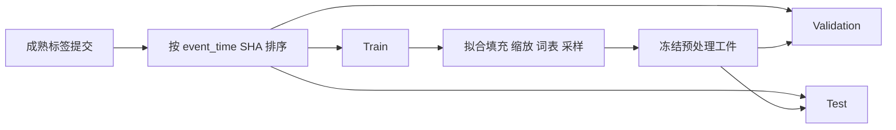

# DefectGuard 数据与算法规格

2026-10-28原生读取计量/监督专项：见[本批指导](development/原生读取分阶段量测与验收.md)。有效解析语义与PARSER_VERSION不变；最终输出/时限/监督越界须拒绝。parser源码变化只绑定后续新提取，不回写旧工件/标签/来源资格。

2026-10-28复核分级：依[Agent辅助复核与人工准入安排](decisions/2026-10-28-Agent辅助复核与人工准入安排.md)，本次A/B登记为agent辅助外部意见，尚不满足独立人工认证。工程和合格资产的受限研究可继续，专业人审不是开工条件；来源独立确认、Gold/噪声率及依赖该来源的产品终验/发布之前须先补齐适任人员核验、差异处置和所需其它证据。不能以两表一致改标签/清理样本或提高旧readiness，也不预设agent或非适任人员的判断更可靠。专业审核可用agent辅助，须披露工具及实际真人核验责任，不能先发布后追认。

2026-10-15 第二十四阶段当前：限定语义准入工程已验收，交付660条train/validation可追溯上下文与冻结向量、64个未标注未来身份、双人来源复核空白材料及机器准入报告。新分类器拟合/旧test评分为0，hunk覆盖、校准、许可/人工与独立评估等8项门槛未通过，语义产品P1/候选发布仍未完成。研究LR/RF应用和第二十三阶段负结果保持。工作流、真实完成程度及协助条件见[本批报告](reports/2026-10-15-第二十四阶段语义准入准备报告.md)和[准入指导](development/语义准入与独立复核准备.md)；不保证所有历史或潜在问题一定可解决。

## 第二十一阶段已交付增量（历史记录）

published_binary_12_v1使用原发布银标/作者epoch做后验研究，不补LT/类型、不用原fix当产品FIX。默认70/15/15时间同组或canonical留出，同值重复合并/冲突拒绝，各分区两类，冻结成员/源/代码摘要；比例至多六位小数，原浮点以canonical文本无损保存/导出，不加容差。原资产/FeatureRun/review不改，history/candidate/semantic/type均false；金标/负例与代码重叠未认证。见 [指南](development/用途分离数据集与验收.md)，模型下一批才拟合train-only处理。

第二十二阶段交付记录（保留历史入口）：研究LR/RF的0011模型表、可靠训练/监督进程、A20/A21/A23、研究工件注册与页面已实施，A22因研究用途不兼容明确拒绝产品发布。固定106674数据双seed及重复概率复现、真实Worker故障恢复和正常数据备份/隔离恢复已有证据；完整回归/新卷/最终SHA CI另按本批报告登记。生产/历史/候选资格不晋升；预训练语义/融合P1随后。见 [当前模型指南](development/LR与RF研究训练及验收.md)。

## 1 版本与时间口径

- `event_time`：以 committer time 为主要排序时间，并使用 SHA 作为稳定并列键；原始 author time 和 committer time 均保留。
- `label_version`：Fix 规则、SZZ 变体、观察窗口、父提交和过滤策略的组合版本。
- `feature_version`：十四维公式、身份别名、子系统映射和语义 tokenizer 的组合版本。
- `dataset`：标签、特征、快照时间、时间边界及预处理配置形成的不可变数据集版本。
- `effort = LA + LD`：全部 effort-aware 指标的统一成本近似。

## 2 Fix 识别

| 等级 | 规则 | 默认处理 |
|---|---|---|
| High | 关联 Issue 明确为 bug，且存在关闭、修复或等价关系 | 纳入 |
| Medium | message 命中带词边界的缺陷修复关键词，可审计和抽检 | 可配置纳入 |
| Low | 只有普通 Issue ID、模糊词、文档修正或回滚 | 不自动纳入 |

每条证据保存 `evidence_type`、`evidence_value`、`confidence`、`rule_version`、`review_status` 和来源摘要。规则必须覆盖大小写、否定语境、单词边界、文档变更和回滚等误报场景。

第九阶段实现fix-evidence-v1及规则摘要；include_medium政策随每轮冻结。只按接受HEAD可达/已解析集合分析，保留每轮判定和Issue首次观测；新轮重算不覆盖旧证据/复核。人工确认、拒绝、恢复待复核带revision与审计理由，不等同SZZ标签。公开GitHub精确bug标签及本仓库直接关闭关系为high，普通引用/PR/不可用观测为low；有限覆盖和略过内容不能当clean。当前英文边界/排除策略、每消息20引用及每轮256查询上限详见 [Fix指导](development/Fix证据与验收.md)。后续标签/特征固定Fix轮次与复核revision，遵守Issue observed_at可见性，防止事后信息泄漏。

## 3 Baseline SZZ

```text
for each confirmed fix commit F:
  select parent according to label_version
  for each changed non-binary file:
    identify deleted or replaced lines in the parent revision
    filter whitespace-only and comment-only lines by filter_version
    blame each remaining line in the parent revision
    persist fix, path, fixed line, blamed commit, blamed line and confidence
aggregate blamed commits as candidate bug-introducing commits
```

约束：

- 普通提交使用唯一父提交；合并提交默认跳过，其他策略必须版本化。
- blame 结果等于 Fix 的直接父提交是合法结果，不能因此排除。
- 重命名跟踪、空白和注释过滤属于 baseline 的工程过滤，不构成 RA-SZZ。
- 首次新增、删除文件、二进制文件和无法解析的行应产生明确状态而非静默丢弃。
- 重跑同一版本应幂等；新规则必须生成新 `label_version`。

## 4 标签成熟度

在数据快照时点 `T`，提交 `c` 的标签为：

- `buggy`：在 `T` 前存在已确认 SZZ 证据；
- `clean`：提交年龄至少为观察窗口 `W`，且完整观察覆盖至W届满，无未决/冲突/略过证据；记录实际完整观察发布的可用时间，不能仅凭在T前未查到证据；
- `unknown`：年龄不足 `W`、证据冲突、解析失败或待人工复核。

`unknown` 不进入监督训练。观察窗口由修复延迟分布或预先声明的规则确定，写入 `label_version`，不得根据测试集表现事后调整。

## 5 Kamei 14 特征

全部历史量只使用当前提交之前的数据。身份在计算前通过版本化别名规则映射到 `author_identity_id`。

| 类别 | 特征 | 计算口径 |
|---|---|---|
| Diffusion | NS | 变更涉及的子系统数；子系统映射规则版本化 |
| Diffusion | ND | 变更涉及的目录数 |
| Diffusion | NF | 变更文件数 |
| Diffusion | Entropy | 每文件 `churn_i=LA_i+LD_i`，`p_i=churn_i/sum(churn)`，`H=-Σp_i log2 p_i`；NF>1 时除以 `log2(NF)`，否则为 0 |
| Size | LA | 新增行数，二进制文件不计 |
| Size | LD | 删除行数，二进制文件不计 |
| Size | LT | 变更前文件 LOC 总和；最终聚合口径固定到 `feature_version` |
| Purpose | FIX | 是否为确认的 Fix；候选预测时使用 0/unknown 策略并记录 |
| History | NDEV | 此提交之前修改相关文件的不同开发者数 |
| History | AGE | 文件距上次修改的天数，以当前文件 churn 加权平均；首次文件按版本化缺失规则处理 |
| History | NUC | 此提交之前相关文件上次修改提交 SHA 的去重数量；不是全部历史修改次数 |
| Experience | EXP | 作者在当前提交之前的总提交数 |
| Experience | REXP | 作者历史提交按 `1/(age_years+1)` 加权之和 |
| Experience | SEXP | 作者此前在相关子系统中的提交数 |

原始特征和模型变换后的输入分开保存。`log1p`、填充和标准化只在 train 拟合，并随模型工件持久化。

第十一阶段固定 `kamei14-dg-v1` 内核与原始质量统计：严格祖先/事件 SHA 前序、recent_window 历史量 null、重命名追踪/删除再新增隔离、当前/祖先内容缺失原因。AGE 保留项目 churn 加权，REXP 为连续 elapsed_days/365.25，与论文有差异。FIX 只用当前事件时点已知冻结证据；候选默认 0 留原因。详见 [Kamei指导](development/Kamei14计算与验收.md)。第十二阶段已完成持久化/A15/A16/页面；成熟度与不可变时间数据集按第十三阶段内核、下一阶段纵向接入拆分，特征交付不等于训练链路完成。

## 6 语义输入

首个语义管线包括：

1. 规范化 commit message；
2. 从 unified diff 分离 added/deleted token；
3. 排除二进制和超限文件；
4. 自训练词表仅在 train 构建；预训练 tokenizer 固定来源/revision，任务拟合与微调只用 train；
5. 固定最大文件、行和 token 数并生成 mask；
6. 保存 tokenizer、词表、截断策略和输入 schema 版本。

TextCNN/DeepJIT-inspired 使用 message 与 diff 两路输入。若未复现论文架构和输入，不得命名为“DeepJIT 复现”。MLP 的 14 维数值输入不算语义模型。

## 7 数据集构建与防泄漏



- 默认 70%/15%/15%，具体边界保存在数据集记录中。
- 同一提交只属于一个 split；数据集创建后不可变，重建生成新 ID。
- SMOTE、下采样或其他重采样只能作用于 train。
- validation 用于校准、阈值和早停，test 仅用于最终报告。
- 单项目时间切分和跨项目实验必须分开报告。
- 数据集内容生成稳定哈希，创建时执行标签、版本和时间一致性审计。

## 8 模型组合

达标模型固定为：

- 经典模型：Logistic Regression、Naive Bayes、SVM、Random Forest、XGBoost、LightGBM；
- 深度模型：MLP、TextCNN/DeepJIT-inspired。

Naive Bayes 在技术探针后根据输入分布选择 Gaussian 或 Complement。SVM 必须支持概率估计或外置校准。BiLSTM 仍属 P2；CodeBERT 等预训练语义候选及专家/语义融合提升产品 P1，先冻结编码器与受控探针再决定微调；课程六经典+MLP/TextCNN矩阵保留，产品新增路线单独验收。

每个 `model_run` 至少保存代码 SHA、依赖摘要、dataset ID、label/feature version、插件名、参数、随机种子、预处理器、校准器、阈值、指标及工件哈希。

## 9 评估指标

### 9.1 Effort-unaware

报告 Precision、Recall、F1、ROC-AUC、PR-AUC、MCC 和混淆矩阵。类别不平衡时 Accuracy 只作辅助指标。测试集仅有单一类别时，不可计算的指标返回 `null` 和原因，不得伪造为 0。

### 9.2 Effort-aware

按 `probability desc, event_time asc, sha asc` 稳定排序，使用 `LA+LD` 作为 Effort：

- `PofB20`：累计 Effort 首次达到总 Effort 20% 时捕获的 buggy 数占总 buggy 数比例；
- `IFA`：遇到第一个 buggy 前检查的 clean 提交数；
- `Popt`：模型排序曲线相对最优和最差曲线的归一化面积，报告离散积分和截断规则。

主要指标使用时间块 bootstrap 或重复实验给出区间或离散度，避免将相邻提交视为完全独立样本。

## 10 概率、风险和解释

- 输出必须是经声明校准器处理的概率，并携带模型和阈值版本。
- 默认队列按校准概率排序。
- `risk_density = probability / max(1, LA+LD)` 仅作为辅助字段。
- 超大变更必须显著标识，不得因密度低而被隐藏。
- 因素解释返回特征名、原始值、贡献值和方向，并明确“不代表因果根因”。
- 概率阈值只能根据 validation 确定。

## 11 算法测试夹具

SZZ golden fixture 至少包含普通修改、文件重命名、空白行、注释行、首次新增、文件删除、二进制文件、合并提交和 blame 到直接父提交。

Kamei fixture 使用可手算的小型 Git 仓库，逐项验证 14 个特征，尤其是 Entropy、AGE、REXP 和历史特征的时间边界，不接受只断言“字段非空”的测试。

## 12 第七阶段采集输入

初次窗口固定HEAD及全部历史/最近N；事件顺序为committer time、SHA，不以拓扑顺序替代时间切分。双时间/时区偏移、父关系、author identity、文件blob/路径/统计/明确略过状态保存；策略native-pydriller-v1详见 [解析指导](development/提交解析与验收.md)。merge diff、二进制、编码/超限内容不伪造零数据或clean标签。后续特征、Fix/SZZ与数据集需显式检查窗口覆盖、状态和版本；最近N之外的历史不能自动算作EXP/NDEV等为零。身份别名新规则、diff/merge策略改变必须独立版本化，不改写已固定窗口。


## 第八阶段同步输入约束

初次parse_checkpoint不变，多轮sync_window记录接受链条及候选范围，事件时间可能倒退而祖先关系仍正常；增量集合由DAG决定。A11是已提交记录并集，包含中断批次，后续数据集须绑定接受HEAD/窗口/规则和成熟标签。recent_window不能提升为完整历史；requires_review候选不得进入训练或预测基线。Fix仍只产生版本化证据，merge/编码/超限略过不是clean；SZZ独立change。见 [同步指导](development/增量同步与验收.md)。

## 第十阶段SZZ实际口径

baseline-szz-v1冻结唯一父、blank/Python/Java词法过滤、Git版本及摘要；默认whole-file rename，不启用-w/-M/-C。Java Unicode预处理转义或未闭合词法为Unknown，其它语言只过滤blank。行级候选保留来源SHA/行/路径/blob及行哈希/可用时间/覆盖与时间资格；直接父合法，有限历史或来源事件晚于Fix则Unknown。Fix启动后复核不会改旧输入，as_of之前不可见的证据不用于历史标签。当前只发布candidate_buggy与Unknown，缺证不产生clean；第4节的clean须在数据集阶段按窗口、完整覆盖和冲突审核后实现。见 [SZZ指导](development/SZZ追溯与验收.md)。


## 第十二阶段特征纵向接入（2026-10-11）

US-06/07个人wang实现A15/A16、feature_run/item（0008_features）、repository.feature可靠任务与FeaturePanel质量页。固定接受HEAD/private快照/解析身份/覆盖/用途/Fix复核，Worker可达性排除未接受并集，冻结输入后每10结果原子发布/恢复；旧令牌与变更输入拒绝。完整质量只在全部发布后出现，缺失保留原因，提供稳定分页/缺失和数值降序下钻。不得构造标签、拟合填充或将晚到FIX回填；US-08/09及A17～19成熟度/不可变数据集与模型仍待后续。详情见 [Kamei指导](development/Kamei14计算与验收.md)；完成验收结果另写本批报告，不标记团队故事Done，不归档change，仅wang。


## 第十四阶段外部研究合同

apachejit-published-13-v1仅保留原12数值列加fix；缺LT，不是kamei14-dg-v1。author_date不冒充committer_time；外部buggy/clean不冒充已确认生产证据。两文件时钟差异、无时区修复与year差异诊断保留，当前无生产label_available_at/purge。每project独立70/15/15同时间组切分只验证结构；历史回放须独立合同/来源审计。公式/FIX可知性需后续版本化；旧内核和轮次不改写。详见 [公开数据指导](development/公开数据审计与历史评估.md)。

## 第十五阶段独立可知特征与horizon回放

kamei14-dg-message-v2保留十三项旧数值/缺失公式，FIX仅当时message文本启发式，0非确认非修复；版本与旧候选默认不同，未来Fix复核先剥除再哈希。historical-horizon-replay-v1目标仅W内观察链接，默认W90/L7预声明假设；完整覆盖/无冲突才能重建负例，Unknown及晚到purge保留，固定原事件70/15/15，train-only权重。标签来源标银/金，实际acquired_at不回填，内核不能认证调用方声明；产品ready仍false。LT/UTC/177个非原最早修复与旧O(N²)限制见 [当前决策](decisions/2026-10-11-历史回放与可知特征合同.md)。

## 第十六阶段在线版本与来源界限

v2 historical/candidate 同消息用途，禁止 fix_run_id，后续人工复核不进入输入/摘要。原生 Git 记录与当前 parser/identity DB 投影逐条比对，特征输入和 native_record_digest 冻结于已接受 HEAD/private storage；不保存新消息正文/diff，不回填取得时间。full 仅在所有可达提交有当前解析记录时表明 feature_population_complete，recent_window 保留六项历史缺失。原解析 merge_skipped 不能证明消息编码，继续 FIX=null/message_unverified；0 仅启发式未命中。

quality 仍原始十四维统计与原因，source_validation 标签覆盖/产品ready为false。旧生产数据集明确拒绝v2；完整负例、最早知识、银金标等级/抽检和新数据集版本仍待下一批。旧数值/FIX合同和已有v1轮次不改写，不能通过补零或外部标签伪造兼容。


## 第十七阶段增量（2026-10-12）

按路径事件/DAG交集计算历史，单链复用祖先前缀，密集路径用旧vector，数值/缺失原因/基础摘要精确等价；indexed源码加入v2 rule hash，新v2总摘要随实现变更。v1规则与旧数据集/历史轮次不改写，限制不提高。

见 [当前指导](development/v2文件历史索引与验收.md) 与 [阶段报告](reports/2026-10-12-第十七阶段v2文件历史索引报告.md)。

## 第十八阶段增量（2026-10-12）

十三维数值/消息FIX/缺失语义保留，新在线rule hash绑定feature_reads；逐字段原生记录、模式、input/native digest验证未省略。标签覆盖和product ready继续false，1000数据库人工SHA微探针不证明训练来源。

见 [当前指导](development/原生特征读取与冻结验收.md) 与 [阶段报告](reports/2026-10-12-第十八阶段原生特征读取与冻结报告.md)。

## 2026-10-14 公开数据、标签扩展与语义衔接

新数据层支持 source/adapter/quality/label/feature/split/task purpose 分离的不可变资产。类型、粒度、位置、严重性和二分类分别保存，缺少类型为unknown，不以模型辅助标签当独立金标。语言可多值/unknown，按真实canonical仓库/内容分组避免fork、cherry-pick、数据源重叠和HDFS/MAPREDUCE泄漏。

现有公开12数值基准不补LT，不将原fix换成产品FIX；缺文本不合成源码。语义输入只保留预测侧message/diff/base，未来fix/Issue用于标签审计而非输入；固定checkpoint/tokenizer、截断/mask/聚合、缓存键和权重来源，新增独立语义版本。自训练词表train-only与冻结预训练词表是不同合同，所有任务拟合/校准/降维仍遵守分区隔离。

raw存档、research_binary/semantic、historical_replay、candidate_release、type/location能力分别核对，旧false不回写。同eligible样本和固定分区比较基线/语义/融合，按语言/仓库报告两类、PR-AUC/MCC/effort/校准与区间；预训练污染/捷径反事实及未知域限制必须披露。实现细则以 [衔接指南](development/公开数据与语义模型衔接指南.md) 为准。

## 第二十阶段实际数据

首条ApacheJIT原始字段和12数值派生保留；原fix元数据不进numeric12，未补LT、类型/位置或历史标签可用时间；逐行语言未认证。HDFS/MAPREDUCE不同cohort同canonical。85起点与2未决修订不改原发布标签或ready，hash验证不认证陈述真实性/人工gold。真实保存/重载及能力结果见 [指导](development/用途分离数据集与验收.md)，研究数据集与预测尚未交付。


## 第二十二阶段模型研究增量

研究十二列和原冻结切分不变；LR train-only标准化、RF原数值。validation按唯一时间组前后半分校准/阈值且各两类；test终评。固定sigmoid/logit、F1网格平局较高阈值、AP/ROC/MCC/Brier/可靠性、LA+LD成本与时间块区间，详见当前模型指南。模型注册不认证标签或产品用途。
