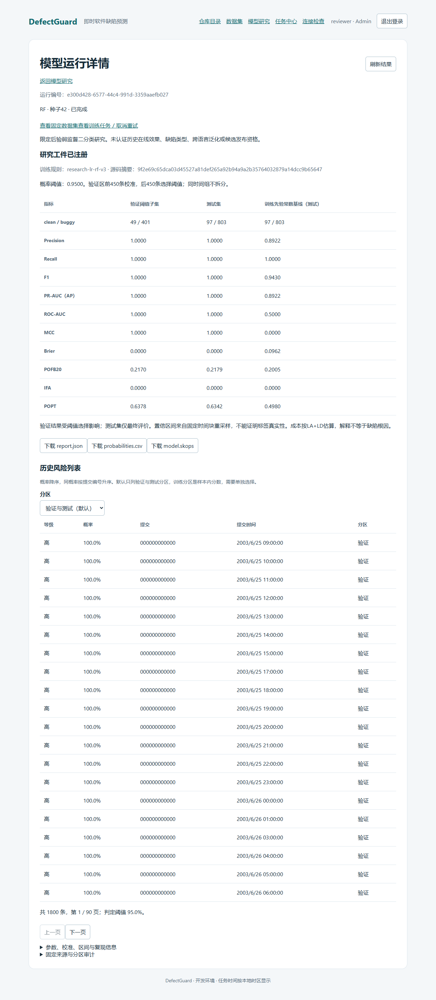
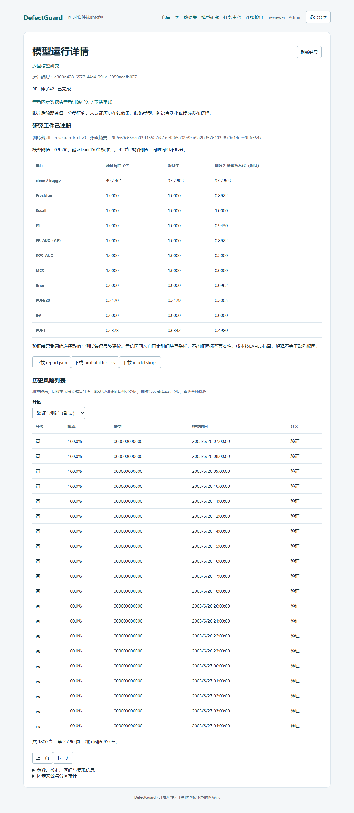
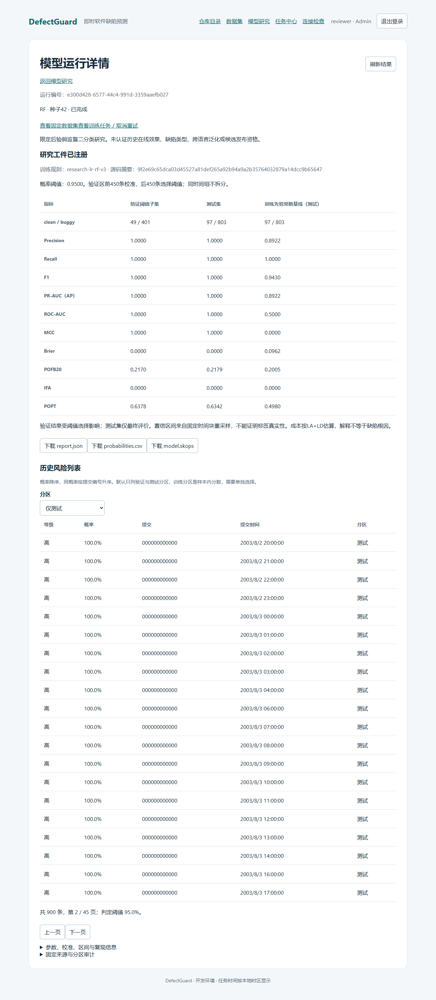
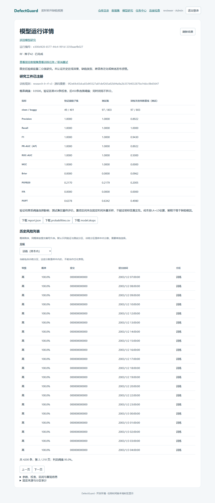

# 浏览器实测记录：历史风险列表（2026-11-06）

## 1. 范围与结论

这次用真实浏览器走了历史风险列表这一条链路：登录、进模型研究、打开一次模型运行、看风险列表、翻页、切换分区。四张截图对应四个状态，都随记录入库。

候选预测页不在这次范围里，因为它在当前代码里没有路由。压测脚本探过 `/api/v1/review/predictions` 与 `/api/v1/predictions`，两者都返回 404，`docs/08-界面与交互规格.md` 里登记的 `/review` 页面也没有对应组件。因此候选预测的浏览器实测无法执行，本记录不拿其他页面的截图顶替。

## 2. 环境

| 项 | 取值 |
|---|---|
| 浏览器 | 本机 Chrome，由 Playwright 以 `channel=chrome` 启动 |
| 页面地址 | `http://127.0.0.1:5173`，Vite 开发服务器，`/api` 代理到 `http://127.0.0.1:18000` |
| 模型运行 | `e300d428-6577-44c4-991d-3359aaefb027`，随机森林，判定阈值 0.95 |
| 数据 | 工程夹具生成的 6,000 条提交，风险列表 1,800 条（验证区与测试区） |
| 脚本 | `apps/web/e2e/risk-list.spec.js` |
| 账号 | 一次性引导账号，口令由本机环境变量提供，不入库 |

## 3. 走查步骤与断言

| 步骤 | 操作 | 断言 |
|---|---|---|
| 1 | 打开登录页，填账号口令并提交 | 出现「任务中心」标题 |
| 2 | 点导航「模型研究」，点该运行的编号链接 | 页面出现「模型运行详情」与「历史风险列表」标题 |
| 3 | 读列表区域 | 每行五列都有值：等级是高中低之一，概率是百分数，提交是十二位十六进制，提交时间非空，分区是验证或测试之一；汇总行写明总条数、页码与判定阈值 |
| 4 | 点「下一页」 | 页码变成第 2 页，整页二十行与第一页完全不同 |
| 5 | 分区下拉选「仅测试」 | 每行分区都变成「测试」，总数变成 900 |
| 6 | 分区下拉选「训练（样本内）」 | 出现「当前包含训练分区，这些分数是样本内的」提示 |

走查脚本每次运行都会重写这四张截图，因此截图与当次运行的环境一致。

## 4. 截图

第一页，验证与测试两个分区，按概率降序：

第二页，条目全部换过，说明分页取的是不同行而不是同一批行重复渲染：

只看测试分区，总数从 1,800 变成 900：

显式要求训练分区，页面给出样本内警告：

## 5. 观察到的情况

切换分区时页码不重置。从第二页切到「仅测试」后，页面停在第 2 页而不是回到第 1 页，总数从 1,800 变 900，页数从 90 变 45。这不影响正确性，因为第 2 页仍然在范围内，但如果切到条数更少的分区而当前页码超过新总页数，就会出现空白页。这次没有构造到这种情形，记下来供后续判断是否要修。

夹具生成的提交编号前十二位都是零，因为夹具按行号补零生成四十位十六进制字符串。页面只显示前十二位，所以在截图里看到的提交列是同一串零。这是夹具的产物，不是页面缺陷；换成真实仓库的提交编号就会各不相同。

风险列表顶部的二十行概率都是 100.0%、等级都是高，因为夹具的标签沿一条线性边界生成、随机森林在验证区就能完全分开，概率因此挤在两端。这次实测要证明的是页面能正确显示等级、时间、分区与翻页，不证明模型有区分能力。

## 6. 未覆盖

页面加载中的骨架、请求失败时的错误提示、移动端窄屏布局这次都没有走查。候选预测页无法走查，原因见第 1 节。
