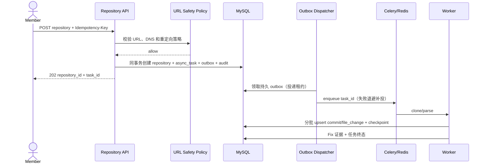

# Design: add-data-collection

## Context

这次要建的是系统的数据入口，要求就三件事：安全、可恢复、可审计。
后面的 SZZ 和特征工程都靠它提供确定的输入。

范围包括公开 HTTPS 仓库的接入、提交与文件变更的解析、以及缺陷修复证据的识别。

登录认证、异步任务与 outbox 投递、以及 A29～A32 这些能力，在 `bootstrap-application` 里已经验收过，
这次直接复用，只扩展采集相关的业务参数、检查点和页面，不再重复实现框架本身。

参与这件事的组件，以及各自负责的部分：

| 组件 | 职责 |
|---|---|
| Repository API | 接收请求、校验输入、幂等创建、查询状态、触发增量同步 |
| URL Safety Policy | 校验协议、凭据、端口、DNS、IP 和重定向 |
| Repository Service | 规范化 URL，维护仓库生命周期，判断是否发生了强制推送 |
| Git Adapter | 在隔离目录里克隆，查询 ref 与祖先关系，控制资源占用 |
| Commit Parser | 用原生 Git 加上 PyDriller 补充信息，产出确定的提交记录 |
| Fix Evidence Service | 对缺陷修复线索分级、版本化，并管理人工复核状态 |
| Task Service | 幂等、心跳、检查点、重试、取消和错误摘要 |

从发出请求到数据落库，完整流程如下：

## Goals / Non-Goals

**Goals:**

- 让用户能安全地接入一个公开 Git 仓库，并把它的提交历史确定地写进数据库。
- 整个过程可恢复、可审计：断了能接着跑，重试不会产生重复数据，状态随时能查。
- 判断出哪些提交是缺陷修复，给出分级证据，而不是直接下结论。

**Non-Goals:**

- 不做 SZZ 回溯。
- 不做 Kamei 特征计算。
- 不做数据集构建和模型训练。

## Decisions

### 决策 1：幂等交给数据库唯一约束兜底

仓库的规范化 URL 唯一，同一仓库下的同一个提交哈希唯一，
异步任务按「任务类型 + 作用域 + 幂等键」唯一。

这几条唯一约束是幂等的最后一层保障。即使请求在网络上重放、或者两个 Worker 抢着写，
数据库也会直接挡住，不会产生重复记录。
同一个幂等键再来一次、但请求内容不一样时，返回 409。

### 决策 2：安全边界

首期只允许 HTTPS，不执行仓库里的任何 hook 或脚本。

校验 DNS 时要覆盖全部 A 记录和 AAAA 记录，而且在重定向发生之前、真正建立连接之前都要再查一遍。
回环地址、内网地址、链路本地地址、保留地址、URL 里内嵌的凭据、以及非常规端口，全部拒绝。

克隆在隔离目录中进行，对时间、大小、并发和日志输出都设上限。
凭据绝不进入 URL、数据库、命令行或日志。

### 决策 3：仓库接入与克隆的闭环

仓库记录里存规范化 URL、所有者、最新任务 ID、状态、默认分支、HEAD 和占用字节数，
另外还有一个不对外公开的 storage_key，用来定位磁盘上的私有目录。
作者表和提交表不在这一步建，等解析阶段再说。

创建仓库的接口只接收一个 url 字段。同一个用户拿同一个幂等键重复提交同一个规范化 URL 时，
直接返回第一次的结果，不再联网；同一个键换了 URL 则返回 409。
换一个键去提交一个已经存在的 URL，返回 REPOSITORY_ALREADY_EXISTS，也不会新建任务。
仓库列表对所有已登录角色可见，创建需要 Member 或 Admin 权限。

URL 和网络这一层的规则比较细，逐条列出：

- 只允许公开 HTTPS、443 端口、ASCII 域名或 IPv4 字面量；带凭据、查询串、片段、编码变形或异常路径的一律拒绝。
- IPv6 字面量 URL 这一期不支持，但 DNS 里出现的 AAAA 记录仍然照常校验。
- GitHub 的 owner 和 repo 名不区分大小写，其它托管平台保留路径大小写。
- DNS 查询有超时；只要解析失败，或者解析出的地址里有一个不安全，就整体拒绝。
- 真正拉代码之前，先确认对方确实在提供 Git 的 HTTP 服务，并且不接受任何重定向。
- Worker 每次建立连接都要重新解析一次域名，只连已经查过、确认安全的那个 IP；
  连上之后还要再核对一次对端是不是同一个地址；证书仍然按原始域名校验。
- 只允许连原始域名加 443 端口，不允许中途换成别的机器，也不允许换成 http、ssh、file 这类协议。
- 不提供任何关闭证书校验的开关。
- Git 运行时禁用全局和系统配置、凭据助手、模板 hook、递归子模块和自动 GC；
  只做 bare 克隆；原始输出不进日志，也不进接口响应。

执行和发布方面：每一次执行用独立的 UUID 目录。
元数据、storage_key 和任务成功状态在同一个事务里发布，并且事务里要确认执行令牌和租约仍然有效。
取消或失败只删掉这次没有发布出去的目录；如果提交结果本身不确定，就把目录留着——
宁可之后人工核对再回收，也不冒险删掉可能已经被成功事务引用的数据。
重试会创建一个后继任务并更新最新任务 ID，旧 Worker 无法覆盖新结果。

### 决策 4：资源与容量保护

默认每个仓库 2 GiB、最长 900 秒；网络传输量最多放宽到仓库预算的两倍；命令输出上限 64 KiB；Worker 并发为 1。

接收请求和开始执行之前，都要求磁盘至少有「预计增长（按仓库预算的两倍算）+ 2 GiB 紧急余量」的空闲空间；
运行期间还会持续检查目录大小和磁盘剩余。
仓库放在 D 盘的 runtime/repositories，API 和 Worker 挂载同一个位置。

初始化时只修改专用根目录和 objects 目录的所有者，不递归改动里面已有的文件。
验收用独立的路径做。

容器里看到的可用空间和宿主机 D 盘的实际余量，必须在验收时对一次账。
任何情况下空间不足都不许改用 C 盘。

### 决策 5：提交与文件变更的解析

初次解析由单独的接口触发，创建仓库的那个接口仍然只接收一个 url，不掺别的参数。
查询提交和文件列表的接口只读已经提交入库的批次，不读正在跑的中间结果。

解析窗口固定在克隆下来的 HEAD 上，可以选全量或者最近 N 个提交，排序先按 committer time 再按 SHA，
保证同样的输入永远得到同样的顺序。
一个仓库初期只有一个窗口，建立之后不再改写；后面要拿到新提交，走的是增量同步。

这一步新增一次迁移，建作者表、提交表、文件变更表，以及绑定根任务的检查点。

每 10 个提交做一次 upsert 并推进检查点，写数据和推进检查点必须在同一个事务里；
最后的批次、检查点、进度和成功状态也要在同一事务提交。
所有业务写入都要先确认执行令牌、租约、最新任务和根任务都对得上。
只有整个窗口解析成功之后，才把仓库标记为「提交已导入」，
避免下游把半份数据当成完整输入。

解析本身用受监督的原生 Git 遍历和读取，hunk 的行号交给 PyDriller。
之所以这么分，是因为库自带的遍历器会自己发起命令，管不住 deadline 和输出上限。

作者邮箱做规范化哈希之后入库，身份带版本号。
merge 提交的元数据保留，但 diff 明确跳过；
根提交、重命名、删除、二进制、编码异常和超限这些状态全部如实记录，不做猜测。

### 决策 6：增量同步

增量同步新增一张同步窗口表，并给仓库加上独立的同步状态和同步根任务。

同步之前必须先完成初次解析。流程是：把仓库完整安全地克隆到一个新目录，
检查旧 HEAD 是不是新 HEAD 的祖先、默认分支有没有变，然后取「新可达集合减去旧可达集合」得到增量提交，
再复用解析阶段那套每 10 个提交一提交的事务。

候选快照在第一次绑定窗口之后就不再改变，重试也不会重新联网；
只有最后一个批次才推进正式的 HEAD 和存储引用。
新旧 HEAD 相同、默认分支也没变时，以零个新提交成功结束，不重复入库。

遇到强制推送、默认分支被改写、旧提交在新快照里消失这类情况，
以检查结果进入 requires_review 状态，暂停并保留候选快照：
不导入分叉的提交，不删旧历史，也不自动重新建立基线。

初次窗口始终是按最近 N 个提交做的，属于有限历史，这一点不会因为后面同步了几次就变成完整历史。

资源预算按「新克隆和建索引的峰值 + 解析用 512 MiB + 2 GiB 余量」估。
D 盘不够就提前拒绝，不转 C 盘。

查询接口返回当前窗口和覆盖度，同步历史窗口走分页子资源。

### 决策 7：Fix 证据的分级与人工复核

识别缺陷修复是个异步任务，启动时先把几样东西固定下来：
已接受的 HEAD、解析版本、覆盖度，以及使用的规则版本和判定政策。
判定范围取「仓库里真实存在的提交」和「已经解析入库的数据」的交集，不把还没接受的同步批次算进来。

新增迁移，加 Fix 轮次、判定、证据和 Issue 观测四张表，并给仓库加上对应状态和根任务。
每 10 条判定连同证据、检查点和进度原子提交；真实 Worker 恢复时保留已经复核过的批次。

证据分两级：

| 情形 | 等级 |
|---|---|
| 只读的公开 GitHub 适配确认是 bug 标签，并且本仓库存在关闭关系 | high |
| 普通 Issue 引用、PR、限流或接口不可用 | low |

观测结果第一次发布就冻结。网络请求期间不持有数据库锁；
如果写回执不清楚，不重新去取；需要重算就另开一轮。

人工复核要写 revision、非空理由和审计记录，三样在同一个事务里。
相同的已接受决策重复提交可以安全重放，冲突则返回 409。
复核不会覆盖规则给出的原始判定，也不会输出 clean 或 SZZ 标签。

新一轮 Fix 与正在进行的解析、同步任务是互斥的；
处于 requires_review 的仓库不会自动解除复核状态。

### 决策 8：失败与恢复

可以自动重试的：暂时性网络错误、Worker 中断、依赖服务短暂不可用。
不自动重试的：输入被拒、资源超限、URL 不安全。

Worker 心跳过期后任务被标记为 stale。
stale 只是一个健康标记，不代表任务结束；
协调器要先把任务条件性地写成 failed，确认写入之后才创建后继任务，原来的终态保持不变。

所有业务批次和检查点都要在同一个事务里检查执行令牌、任务状态和租约是否有效，旧 Worker 无权提交。

投递补偿、排队超时和恢复次数上限复用现有框架的约定；采集这一层另外验证批次的幂等性。

### 决策 9：Windows 深路径兼容

这一条是复验时暴露出来的两个问题，都做了修复。

**问题一是 Git 报 Filename too long。**
修法是让执行克隆的那个组件在 Windows 上给受控的 Git 命令单独打开长路径支持，
只通过子进程的环境变量传进去，不落到任何配置文件里，也不动注册表、PATH、SSH 或文件权限。
证书校验、网络安全、凭据、hook 和容量这几层约束一个都没改。

**问题二是容量扫描漏算了长路径文件。**
后来用真实的打包文件补查时发现，一个 265 字符的文件会让 Python 读不到它的属性，
而旧的容量扫描只统计到 288 字节——
也就是说「长路径克隆成功」并不等于防护生效，当时那个结论其实是不成立的。
受控回归的第二轮跑到 38% 时主动中断，日志和中断原因都保留了，没有声称全量通过。

修复只限定在本地读文件这一层：

- 检查路径时仍然会查祖先目录有没有被替换成软链接之类的重解析点；
- 容量扫描把长路径下的打包文件也算进去，读不了的目录一律拒绝而不是当作 0；
- 清理之前先确认目标落在本轮自己的目录范围内；
- Git 子进程继续使用普通的合法根路径。

## Risks / Trade-offs

| 风险 / 权衡 | 说明 |
|---|---|
| SSRF 防护必须覆盖重定向和 DNS rebinding | 光在入口校验 URL 不够，Worker 每次 CONNECT 都要重新解析并核对对端，实现复杂度因此明显上升。 |
| 不支持 IPv6 字面量 URL | 这是本批明确留下的能力缺口，只支持 IPv4 字面量和 DNS 里的 AAAA。 |
| 强制推送和分支改写只暂停、不自动处理 | 保守策略：保留候选、进入待复核。代价是必须人工介入，换来的是不会静默导入分叉。 |
| 提交结果不确定时保留目录 | 宁可留下孤立目录等人工核对，也不冒险删掉可能被引用的数据，用磁盘空间换数据安全。 |
| 每仓库 2 GiB、900 秒的上限 | 超大仓库会直接失败，需要人工调整参数，或者另做设计。 |
| Worker 并发为 1 | 吞吐受限，换来的是资源可控、出问题好排查。 |
| Fix 证据分级偏保守 | 普通 Issue 引用只给 low，可能低估一部分真实修复。这是刻意的：防的是事后信息泄漏到 SZZ 标签里。 |
| 长路径修复只覆盖本地文件访问 | Git 子进程仍然走普通的合法根路径，路径极端深的时候还是可能受限。 |

## Validation

- 用本地临时 Git 仓库做确定性的集成测试。
- 用一组参数化的地址验证 SSRF 防护。
- 注入批次中断，验证检查点和幂等。
- 用缺陷修复的正例与反例 fixture 验证证据等级和排除语境。
- 测试环境临时起一个 HTTPS Git smart HTTP 服务，配独立的测试 CA，
  通过构造器注入 resolver 和 connector；生产环境不存在关闭 SSRF 或 TLS 校验的配置。
- 拿真实原生 Git 的克隆结果和源端 HEAD 对照；另外验 TLS 拒绝、DNS rebinding、
  取消、租约、数据库约束和提交结果不确定这几种情况。
- 采集入口自己的磁盘检查由任务 1.5 负责，沿用质量优先的容量提示和 2 GiB 紧急写入保护。

参考：[Git 配置](https://git-scm.com/docs/git-config)、
[bare clone](https://git-scm.com/docs/git-clone)、
[DNS 查询超时](https://dnspython.readthedocs.io/en/stable/resolver-class.html)。
